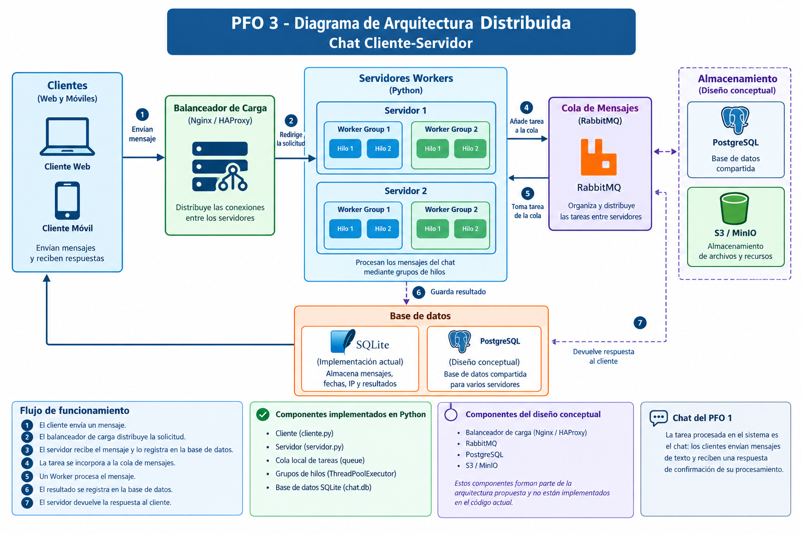

# PFO 3 - Diagrama de Arquitectura Distribuida

## 1. Objetivo

El objetivo de este diagrama es representar la arquitectura propuesta para adaptar el chat del PFO 1 a un sistema distribuido cliente-servidor.

El diseño contempla clientes que envían mensajes, servidores que procesan las solicitudes, una cola de mensajes para distribuir las tareas y sistemas de almacenamiento para conservar la información.

## 2. Diagrama de arquitectura

El siguiente diagrama representa los componentes principales de la arquitectura propuesta y la comunicación entre ellos.

## 3. Componentes del sistema

### 3.1. Clientes web y móviles

Son las aplicaciones utilizadas por los usuarios para enviar mensajes al servidor y recibir las respuestas correspondientes.

En la implementación actual, el cliente está desarrollado en Python.

### 3.2. Balanceador de carga

Se propone utilizar Nginx o HAProxy para distribuir las conexiones entrantes entre diferentes servidores.

Esto permitiría repartir la carga de trabajo y evitar que todas las solicitudes dependan de un único servidor.

### 3.3. Servidores Workers

Son los servidores encargados de recibir las solicitudes y procesar los mensajes enviados por los clientes.

Cada servidor puede disponer de un grupo de hilos (*pool de hilos*) para ejecutar varias tareas concurrentemente.

En la implementación actual, se utilizan dos grupos de Workers, cada uno con dos hilos, dentro del mismo proceso Python.

### 3.4. Cola de mensajes

Se propone utilizar RabbitMQ para organizar las tareas pendientes y permitir que distintos servidores intercambien y distribuyan el trabajo.

En el programa desarrollado se utiliza `queue` de Python, que cumple la función de organizar las tareas dentro del servidor, pero no reemplaza todas las capacidades de RabbitMQ.

### 3.5. Base de datos

Se propone PostgreSQL como alternativa para una arquitectura distribuida ampliada, donde varios servidores necesiten acceder a una base de datos compartida.

La implementación actual conserva SQLite, mediante el archivo `chat.db`, para almacenar los mensajes recibidos y los resultados de su procesamiento.

### 3.6. Almacenamiento de archivos

Se propone utilizar S3 o MinIO para almacenar archivos y recursos adicionales si el sistema los necesitara.

Este componente forma parte del diseño conceptual y no está implementado en el programa actual.

## 4. Flujo de funcionamiento

El flujo de las solicitudes se desarrolla de la siguiente manera:

1. Un cliente envía un mensaje.
2. El balanceador de carga distribuye la solicitud hacia uno de los servidores disponibles.
3. El servidor recibe el mensaje y lo registra en la base de datos.
4. La tarea se incorpora a una cola de mensajes.
5. Un Worker toma la tarea y procesa el mensaje.
6. El resultado del procesamiento se registra en la base de datos.
7. El servidor devuelve la respuesta al cliente que realizó la solicitud.

En la implementación actual, los pasos relacionados con el balanceador y los servidores independientes se representan conceptualmente. El programa utiliza un único servidor Python, una cola local y dos grupos de Workers.

## 5. Diferencia entre el diseño y la implementación

El diagrama representa una arquitectura distribuida ampliada, mientras que el código desarrollado implementa una versión simplificada para demostrar sus mecanismos principales.

| Componente | Diseño conceptual | Implementación actual |
|---|---|---|
| Clientes | Web y móviles | Cliente Python |
| Balanceador | Nginx o HAProxy | No implementado |
| Servidores | Varios servidores independientes | Un servidor Python |
| Workers | Grupos de hilos por servidor | Dos grupos de dos hilos |
| Cola de mensajes | RabbitMQ | `queue` de Python |
| Base de datos | PostgreSQL | SQLite |
| Almacenamiento | S3 o MinIO | No implementado |

## 6. Conclusión

La arquitectura propuesta permite visualizar cómo podría ampliarse el chat del PFO 1 para distribuir el procesamiento entre varios servidores.

La implementación actual constituye una primera adaptación que incorpora comunicación mediante sockets TCP, almacenamiento persistente, una cola de tareas y procesamiento concurrente mediante Workers.
