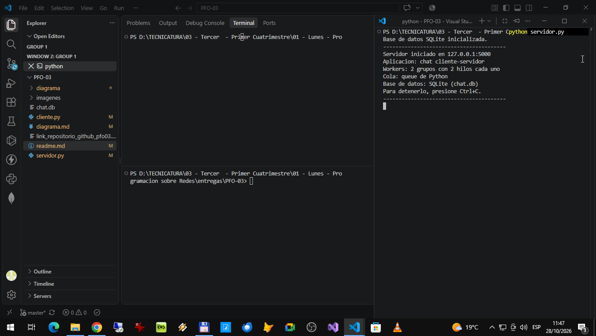
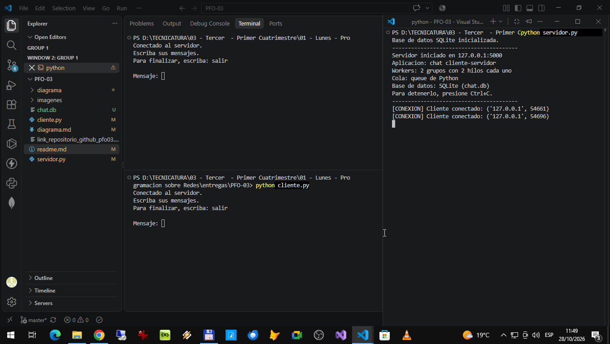
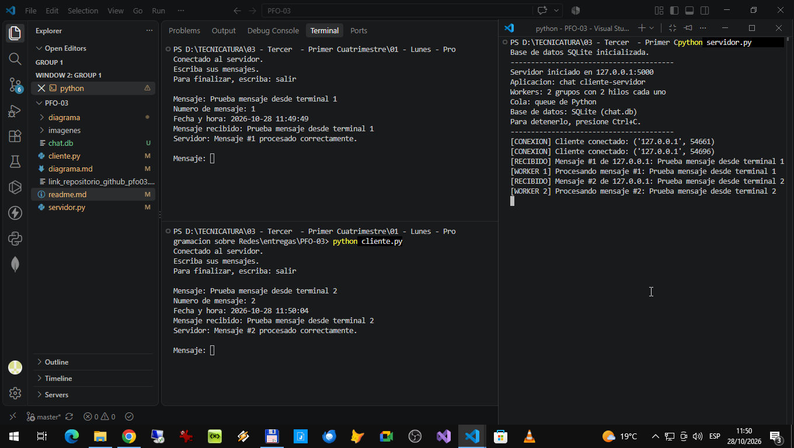

# PFO 3 - Sistema Distribuido Cliente-Servidor

## 1. Objetivo

El objetivo de este trabajo es implementar una aplicacion
cliente-servidor en Python utilizando sockets y conceptos
de sistemas distribuidos.

El servidor recibe tareas de los clientes, las organiza
en una cola y las distribuye entre grupos de trabajadores
para procesarlas.

## 2. Tecnologias utilizadas

- Python
- Sockets TCP para la comunicacion entre cliente y servidor.
- JSON para intercambiar los mensajes.
- threading para atender conexiones en hilos separados.
- queue para organizar las tareas pendientes.
- ThreadPoolExecutor para ejecutar tareas en paralelo.


## 3. Estructura de Archivos

## Estructura del proyecto

```text
PFO3/
|
|-- servidor.py ................. Servidor que Recibe y distribuye las tareas.
|
|-- cliente.py .................. Cliente Envía tareas y recibe resultados.
|
|-- README.md ................... Documentación general del trabajo.
|
|-- diagrama.md ................. Explicación de la arquitectura propuesta.
|
|-- diagrama/
|   `-- diagrama.png ............. Imagen del diagrama de arquitectura.
|
`-- imagenes/
    |-- pfo03-imagen01.png ....... Captura imagen servidor iniciado esperando.
    |
    |-- pfo03-imagen02.png ....... Captura imagen clientes iniciados esperando.

    `-- pfo03-imagen03.png ....... Captura imagen servidor y clientes procesando.
```


## 4. Funcionamiento

El cliente se conecta al servidor y envia una tarea.
El servidor recibe la solicitud y la coloca en una cola.

Un mecanismo de distribucion asigna las tareas a los
grupos de trabajadores disponibles.

Una vez procesada la tarea, el resultado se devuelve
al cliente mediante la misma conexion.

Para finalizar, el cliente puede enviar la palabra SALIR.


### Ejemplo de tarea implementada

Para demostrar el funcionamiento del sistema cliente-servidor, se implementó como ejemplo una operación de suma entre dos números.

La suma se utiliza únicamente como una tarea de prueba sencilla, que permite verificar el envío de solicitudes desde los clientes, la recepción y distribución de las tareas por parte del servidor, su procesamiento mediante los Workers y la devolución del resultado al cliente.

El sistema está planteado para demostrar estos mecanismos de comunicación y procesamiento. La operación de suma es un ejemplo práctico y no constituye una limitación de la arquitectura propuesta.


## 5. Ejecucion

Se necesita tener Python instalado.

Primero, abrir una terminal y ejecutar:

    python servidor.py

Luego, abrir otra terminal y ejecutar:

    python cliente.py

Se puede ingresar una suma, por ejemplo:

    10+5

Para finalizar la conexion, ingresar:

    SALIR


## 6. Arquitectura conceptual

El diseño propuesto contempla:

- Clientes web y moviles.
- Balanceador de carga Nginx o HAProxy.
- Servidores trabajadores con grupos de hilos.
- Cola de mensajes RabbitMQ.
- Base de datos PostgreSQL.
- Almacenamiento de archivos S3 o MinIO.

Estos componentes se representan en el diagrama
conceptual y no forman parte de la implementacion
Python desarrollada en esta entrega.

## 7. Pruebas

Se realizaran pruebas de conexion, envio de tareas,
recepcion de resultados y manejo de entradas incorrectas.

Se incorporaran capturas de pantalla para mostrar
el funcionamiento de los programas.

### Servidor inciado esperando


### Clientes iniciados esperando


### Servidos y Clientes procesando

